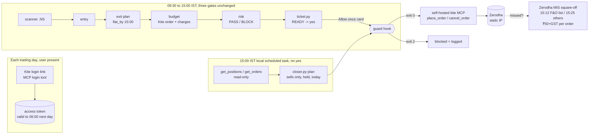

# Plan: move the pack to NSE on Zerodha

> Status: **approved as the basis by Fable on 2026-11-12, with R1 to R10
> folded in below** (each marked `[Rn]`). First written on `plan/india-zerodha`
> at `1259b8c`; carried on `feat/india-zerodha` (R10). B1 may start. B0 needs
> the owner's own word. B2 to B4 wait for Fable's ruling on the B0 notes.
> Everything under "Sources" was read on 2026-11-12. Where a fact is
> secondary or could not be confirmed, the plan says so.

## 0. What the owner asked, and the rulings so far

The owner, verbatim: *"All the orders should automatically close at 3 pm
last. No order should be placed after that. Place orders only after 9:30 am.
Trade should happen only on Indian market using zerodha"*

Owner decisions: the 3 pm close is **"Close without asking"**, and the
US-only skills are **"Remove pelosi, rebuild the rest"**.

Fable's rulings D1 to D6 are taken as given. Where this plan adds to them or
pushes back, it says so in §9 ("Decisions this plan needs").

## 1. Findings that shape the design

Each of these comes from current documentation (see §11). Each one changes
something Fable would otherwise assume.

| # | Finding | Consequence for the plan |
|---|---|---|
| F1 | The **hosted** Kite MCP (`https://mcp.kite.trade/mcp`) "excludes potentially destructive trading operations for security" [S1]. A Zerodha developer on the repo, cited secondhand [S2], says that on it "order placement is not available". | **The hosted route cannot place orders.** Orders need a **self-hosted** `zerodha/kite-mcp-server` with the user's own Kite Connect API key and secret. |
| F2 | From **1 April 2026, a static IP is mandatory for any order placement through the API**. The IP is whitelisted in the Kite developer profile (one primary plus an optional secondary, changeable once a week). Data, positions and orderbook calls work from any IP [S3]. The FAQ page [S4] gives "1 April 2025", which looks like a stale year. | The machine that places orders must leave the internet from a whitelisted static IP. **A cloud scheduled task cannot place the 3 pm close** (it runs on Anthropic's IPs), so the 3 pm run must be a **local** Desktop task on that machine. This is an owner prerequisite, and many home connections do not have a static IP. |
| F3 | Kite Connect **Personal is free** and covers "full order, GTT, and alerts management", but has **"no live market data or historical data"**. **Connect costs ₹500/month** per API key and adds WebSocket data and historical candles. The limit is 10 orders/second per client [S4]. | Orders cost nothing extra on Personal. Quotes and bars must come from elsewhere: Yahoo `.NS`, as today (F9), or the paid plan. |
| F4 | The access token **expires at 6 AM the next day** ("regulatory requirement"), or earlier on a master logout from Kite Web. Login is a browser redirect giving a `request_token` that lives "a few minutes", exchanged with a SHA-256 checksum [S5]. The MCP's `login` tool returns the link [S1]. | The user logs in **once each trading morning** in the browser. Claude must never automate the login (it would need the password and TOTP, which is prohibited). A morning login covers the 3 pm run. |
| F5 | The MCP's `place_order` fields are `variety` (regular/co/amo/iceberg/auction), `exchange`, `tradingsymbol`, `transaction_type` (BUY/SELL), `quantity`, `product` (CNC/NRML/MIS/MTF), `order_type` (MARKET/LIMIT/SL/SL-M), `price`, `trigger_price`, `validity` (DAY/IOC/TTL), `validity_ttl`, `disclosed_quantity`, `iceberg_legs`, `iceberg_quantity` and `tag` (20 chars). **It has no `market_protection`** [S6]. No tool sets a destructive hint. | The REST API documents `market_protection` for MARKET and SL-M orders [S7], and forum threads (not official) say a missing value is rejected since 1 April 2026 [S8]. **Plan: LIMIT and SL (limit) orders only**, for entries, stops and the 3 pm close. MARKET and SL-M are BLOCKed. This is checked on a real account in B0. |
| F6 | **Zerodha has no paper account and no API sandbox** [S9]. | `"paper": true` cannot mean a paper broker any more. Proposal (§9 Q1): it becomes a **dry run**. ticket.py prints the exact `place_order` input, and the SKILL tells Claude not to call the tool. It stays the default. |
| F7 | NSE cash session: pre-open 9:00 to 9:15, **normal market 9:15 to 15:30 for non-F&O stocks** [S10]. Since **3 Aug 2026**, **F&O-list stocks stop continuous trading at 15:15**, followed by a Closing Auction Session from 15:15 to 15:35 [S11]. | The entry window (09:30 to 15:00) sits inside both sessions. "Close" means 15:30 or 15:15 depending on the stock, so the tools need the F&O list (F10). |
| F8 | **Zerodha's MIS auto square-off is 15:25 for equity** (moved from 15:20 on 26 Dec 2025) [S12], and **15:12 for F&O-list stocks** under CAS [S11]. It costs **₹50 + 18% GST per order squared off** [S13][S14]. | The backstop in D5 works. Anything the 3 pm run misses is closed by Zerodha by 15:12 or 15:25, for about ₹59 an order. |
| F9 | Yahoo's chart and spark endpoints serve NSE as `SYMBOL.NS` (INR, `gmtoffset` 19800, `exchangeTimezoneName` Asia/Kolkata). Checked live today for `RELIANCE.NS` and `TCS.NS`. | The scanner, entry, exit, timemachine and alerts keep the endpoints they already use. Only the symbol suffix, the clock and the session change. Stooq is dropped. |
| F10 | NSE publishes CSVs that answer a plain GET: `EQUITY_L.csv` (2,397 EQ-series stocks today) and `fo_mktlots.csv` (226 lines, the F&O list). Kite's public `api.kite.trade/instruments/NSE` dump answers with no auth and carries `tick_size` and `lot_size`. All three were checked today. | They replace Nasdaq Trader's symbol directory. `tick_size` replaces cent rounding (most NSE stocks tick at ₹0.05; some at ₹0.01). |
| F11 | NSE 2026 trading holidays: `nseindia.com/api/holiday-master?type=trading` answers today with **16 weekday closures** (including 15 Jan, Maharashtra municipal elections) plus 4 weekend dates. The Muhurat session is Sunday 8 Nov 2026 [S15]. This matches Zerodha's calendar [S16]. The base circular is NSE/CMTR/71775 of 12 Dec 2025 [S17]. **2027 is not published yet**; NSE usually publishes in December. A Sunday 1 Feb 2026 (Budget) live session also took place [S18]. | The table is hard-coded for 2026, and 2027 is a one-line data batch when NSE publishes it. Special sessions (Budget Sunday, Muhurat) are **not trading days for this pack**, so entries fail closed (§9 Q6). |
| F12 | Zerodha equity intraday charges: brokerage is the lower of 0.03% or ₹20 per executed order. STT is 0.025% on the sell side, NSE transaction charges are 0.00307%, GST is 18%, stamp duty is 0.003% on the buy side, and SEBI charges ₹10/crore [S14]. | Today's loss figure is price-only. Proposal (§9 Q4): budget adds an **estimated charges line** and risk counts it in the max loss. |
| F13 | GTT is for CNC/NRML, **not MIS**. Bracket orders are not offered. A cover order (`variety: co`) is MIS with a compulsory stop [S19] (forum replies by Zerodha staff, not formal policy). | The one-yes **bracket** (entry, stop and target) cannot carry over. See §4.2 for the replacement. |
| F14 | Desktop **local** scheduled tasks run only while the app is open and the machine is awake. Each task starts a few minutes after its time, by a fixed offset per task. A missed run gets **one catch-up run on wake**, which can be hours late. Permission mode and "always allow" approvals are **per task** and revocable. MCP servers come from config files [S20]. A PreToolUse hook that **exits 2 blocks the tool call even if its JSON says allow**. A hook that **times out does not block** [S21]. | §5 builds the 3 pm run on a local task, with a code-enforced **guard hook**. The guard is written to fail closed on everything except a timeout, and the timeout risk is named. |

## 2. Target architecture



* **One broker:** a self-hosted `zerodha/kite-mcp-server` [S1] on the user's
  machine, using a Kite Connect Personal key (free). D1 applies; there is no
  Alpaca and no IBKR.
* **Clock:** IST is UTC+5:30 all year with no summer time, so the nine
  `eastern_offset` copies become a constant. The five `NYSE_HOLIDAYS` or
  `trading_day` copies (alerts, entry, exit, risk, scanner) become the NSE
  table. `--now` reads IST. The machine's
  zone is never read (D1).
* **New guard:** `trader-broker/guard.py` is a stdlib PreToolUse hook on
  `mcp__kite__place_order`, `mcp__kite__cancel_order` and
  `mcp__kite__modify_order`. It applies to **every** session in the project,
  not only the 3 pm one (§5.3).
* **Where the guard exists [R7]:** only where hooks run, and only under the
  tool names it matches. The surface is **Claude Code sessions** (the Code tab
  and its local scheduled tasks) opened on this project folder. The hook is
  registered in the project's `.claude/settings.json` (from
  `settings.example.json`, installed by the owner), and the kite MCP server is
  declared in the project's `.mcp.json` under the server name `kite`, so its
  tools are exactly `mcp__kite__*`. `claude_desktop_config.json` is the chat
  app's file and has no hooks, so the pack's setup no longer uses it for the
  kite server. `closer.py precheck` and `ticket.py` **refuse** when the
  project settings do not register `guard.py` as a PreToolUse hook for all
  three tool names.

## 3. Answers to the seven questions

### Q1. Which Zerodha route places orders, and what it costs

| Route | Places orders? | Cost | Notes |
|---|---|---|---|
| Hosted Kite MCP `mcp.kite.trade/mcp` | **No** [S1][S2] | Free | Fine for read tools (quotes, positions), but adds a second login. Not used. |
| **Self-hosted `zerodha/kite-mcp-server`** | **Yes** (`place_order`, `modify_order`, `cancel_order`, plus GTT tools) [S1][S6] | Free software. Kite Connect **Personal: free** [S4] | Needs Go 1.21+ or a built binary, `KITE_API_KEY` and `KITE_API_SECRET` in its env (never in chat), `APP_MODE`, and `EXCLUDED_TOOLS` [S1]. Orders must leave from the whitelisted static IP [S3]. |
| Kite Connect API from our own Python | Yes [S7] | Same | Rejected: the pack's tools would hold the key and token. Keeping orders in an MCP tool keeps Claude's own permission card as the third gate. |

* **Tool names:** `place_order`, `modify_order`, `cancel_order`, `get_orders`,
  `get_trades`, `get_order_history`, `get_order_trades`, `get_positions`,
  `get_holdings`, `get_margins`, `get_quotes`, `get_ltp`, `get_ohlc`,
  `get_historical_data`, `search_instruments` and `login`. The fields are in
  F5.
* **Hiding tools:** the self-hosted server is started with
  `EXCLUDED_TOOLS=place_gtt_order,modify_gtt_order,delete_gtt_order`. GTT is
  delivery-only (F13) and outside this pack.
* **Login:** each morning, Claude calls `login` and the user opens the link and
  logs in themselves. The token lasts until 06:00 the next day (F4). Whether
  the server keeps its session across a restart is to be checked in B0.
* **The API secret [R9]:** the repo's example config holds placeholders only
  (`KITE_API_KEY=<your key>`, `KITE_API_SECRET=<your secret>`). The real values
  sit in a file outside the repo that only the server reads. No tool in the
  pack, no test and no review packet reads, prints or logs it; a `test_repo`
  check asserts the example has placeholders only.

### Q2. Square-off, charges, session hours and holidays

* **Square-off:** 15:25 for equity [S12]; 15:12 for F&O-list stocks [S11];
  ₹50 + GST per order [S13].
* **Charges:** see F12 [S14].
* **Session:** 9:15 to 15:30, and 9:15 to 15:15 plus CAS for F&O stocks
  [S10][S11].
* **Holidays:** the source is the NSE circular (NSE/CMTR/71775 for 2026 [S17])
  together with `api/holiday-master`.
* **Special sessions:** Muhurat, 8 Nov 2026 [S15]; Budget Sunday, 1 Feb 2026
  [S18]. **2027:** not yet published. The table has a maintenance test (B1)
  that fails once the year has no data.

### Q3. The 3 pm run

See §5.

### Q4. Data sources

| Need | Today | India | Status |
|---|---|---|---|
| Bars, quotes | Yahoo `chart`/`spark` (US) | Same endpoints, `SYM.NS` | Checked live (F9). Unofficial, as today. |
| Universe | Nasdaq Trader SymDir | NSE `EQUITY_L.csv`, series EQ | Checked live (F10) |
| F&O list (sets the 15:12/15:15 times) | n/a | NSE `fo_mktlots.csv` | Checked live (F10) |
| Tick size | cents | Kite `instruments/NSE` dump (public) | Checked live (F10) |
| Alerts' second price source | Stooq (Warsaw time) | **Dropped.** If the first source fails, Kite `get_ltp` through MCP is a Claude step, not a tool fetch | Proposal |
| News headlines | Yahoo RSS (US) + SEC 8-K Atom | Google News RSS `hl=en-IN&gl=IN` per company, plus the NSE corporate-announcements JSON (`api/corporate-announcements?index=equities&symbol=`) | Both answered today. Yahoo `.NS` RSS came back **empty**, so it is dropped. |
| Earnings facts | SEC XBRL companyfacts | NSE `api/corporates-financial-results?...&period=Quarterly` (130 rows for RELIANCE, each with an Ind-AS XBRL link) | Answered today. Unofficial, and NSE can rate-limit or demand cookies. |

### Q5. US-only rules

| Rule | Fate |
|---|---|
| `pdt_guard` and the 5-day count | **Removed.** India has no PDT rule. The README FINRA paragraph is replaced. |
| `sec_user_agent`, `SEC_USER_AGENT` | **Removed** with SEC. NSE asks for none (we send a generic UA, as today). |
| Notional (rupee-amount) orders, `fractional` | **Removed.** Kite takes integer `quantity` only [S7]. |
| `extended_hours` and R6's format rule | **Removed.** No extended session in NSE cash. `variety: amo` is **BLOCKed** (an AMO is an order placed outside the window). |
| `opg`/`cls`, `gtc`, `fok`, `ioc` | `validity` **DAY only** for entries. IOC is allowed for the 3 pm close only (§5.2). TTL is BLOCKed. |
| Fingerprint field list (`ALPACA_FIELDS`) | It becomes `KITE_FIELDS` = the F5 list minus the iceberg fields (BLOCKed). Existing broker logs no longer match, which is harmless: a fingerprint is per day. |
| Bracket order | Replaced (§4.2). |
| Currency, rounding | `$` becomes `₹`, and money is shown with Indian grouping (₹1,23,456.70) (§9 Q8). Prices round to the stock's `tick_size`, not cents. `*_usd` config keys are renamed `*_inr` (§9 Q8). |
| Ticker shape `^[A-Z]{1,5}...` and OCC options regex | NSE symbols run to about 20 characters and include `&` and `-` (e.g. `M&M`, `BAJAJ-AUTO`). The regex follows `EQUITY_L.csv`, and the OCC regex is removed (options stay off). |
| `allow_short` | Stays **false**, and it matters more now: an MIS SELL with no position **is a short sale**. Risk BLOCKs a SELL entry, and the guard checks every SELL against what is held (§5). |

### Q6. Per skill

| Skill | Fate | Files |
|---|---|---|
| trader-pelosi | **Removed** (owner) | `trader-pelosi/` and `tests/test_pelosi.py`, `tests/fixtures/trader-pelosi/`, plus the README rows and the "eleven" counts |
| trader-scanner | Changed | `scan.py` (universe, `.NS`, IST session 9:15, 75 five-minute bars, F&O flag), `SKILL.md`, the fixtures re-captured |
| trader-entry | Changed | `entry.py` (ORB 9:15 to 9:30 range; entries 09:30 to 15:00; NSE calendar), `SKILL.md`, the fixtures |
| trader-exit | Changed | `exit.py` (`flat_by` fixed at 15:00, tick rounding), `SKILL.md` |
| trader-timemachine | Changed | `timemachine.py` (75 bars, NSE calendar, IST), `SKILL.md`, a new 60-day fixture |
| trader-budget | Changed | `size.py` (Kite order shape, §4.2; ₹; charges), `config.example.json`, `targets.example.json` (the Berkshire 13F example has no Indian equivalent; §9 Q9), `SKILL.md` |
| trader-risk | Changed | `check.py` (D2/D6 window, removed rules, Kite format, F&O-aware close), `SKILL.md` |
| trader-broker | Changed, plus 2 new tools | `ticket.py` (Kite tool input, dry run), **`closer.py`**, **`guard.py`**, `claude_desktop_config.example.json` (self-hosted kite), **`settings.example.json`** (the hook), `SKILL.md` (Setup A becomes Zerodha; Setup B/IBKR is removed) |
| trader-alerts | Changed | `alerts.py` (IST, NSE calendar, `.NS`, no Stooq; the 15:00 close alert), `alerts.example.json`, `SKILL.md` |
| trader-news | **Rebuilt** | `news.py` (Google News IN + NSE announcements; the seen-state from #3 kept), `SKILL.md`, new fixtures |
| trader-analyst | **Rebuilt** | `facts.py` (NSE results list + Ind-AS XBRL), `metrics.example.json`, `SKILL.md`, new fixtures |

**Impact table:** every user-facing surface that the move makes false.

| Surface | What becomes false | Handled in |
|---|---|---|
| README: tagline, "Yahoo Finance… Nasdaq Trader… SEC EDGAR and the House Clerk", "11 Claude skills", "The eleven" table, install text | Sources, count, Pelosi | B7 |
| README: the reel (TSLA, 19 Oct 2026, $5,000, 3:55 PM) | Every number | B7, from a real NSE day captured in B5 (§9 Q7) |
| README: "Nothing in this pack can place an order on its own", "No trade goes through until you say yes" | **False after D4** for the 3 pm sells | B4 rewords them: entries need a yes; only the 3 pm close of today's own positions does not |
| README fine print: Paper first / Alpaca, FINRA PDT, STOCK Act, US tax | All US | B7 (Indian replacements, each cited) |
| `.claude-plugin/plugin.json` description "11 Claude skills… before you risk a dollar" | Count, currency | B7 (no version bump; §9 Q10) |
| Every `SKILL.md`: ET times, $, Alpaca, NYSE | Times and broker | In the batch that changes that skill |
| `tests/test_repo.py`: eleven folders, reel copy, safety-rule wording, paper default, the example-config limits | Count, wording | B1 (count), B3 (paper/dry run), B4 (safety rule), B7 (reel) |
| Fixtures: all of Yahoo US, Stooq, SEC, House | US data | Replaced per batch; nothing US is left at the end (B7 adds a test for it) |
| Users' existing `trader/` folders (broker log, config with `*_usd`, `pdt_guard`, `sec_user_agent`) | Old keys | Risk and budget **refuse** a config with a US-only key, naming it and the replacement, so an old config never half-applies |

### Q7. Order of work

See §8.

## 4. Entries (D2, D6) and the order shape

### 4.1 The window is absolute (D2, D6)

* Entries are allowed only when **09:30 ≤ now < 15:00 IST** on an NSE trading
  day (§9 Q6 on special sessions). Outside that, risk BLOCKs, and
  `entries_until` keeps its shape (now always `"15:00"`, or None on a closed
  day).
* `no_entries_before` and `no_entries_after` become **tighten-only**. A later
  start or an earlier end is honoured. `null`, an earlier start, or a later end
  is a **config BLOCK** that names the owner's rule. `flat_by` is likewise
  fixed at `"15:00"`; an earlier value is allowed, a later one BLOCKs.
* **R4's window-off code is deleted:**
  * `window_off`;
  * the `closed_now` and `closed_warn` branches in `check()`;
  * the `plain_day` parameter of `entries_until`;
  * the matching R4/R6/R7 test rows.
  
  `market_closed` and `calendar_warning` stay, in their NSE versions. This
  removal is listed in B2's "Features kept" table as **narrowed by the owner's
  rule**.
* **The broker's 15-minute freshness rule and R5/R8 check binding are kept
  unchanged.** A yes still expires at the cut-off, which is now 15:00.

### 4.2 The order risk passes (replacing the bracket)

Kite has no bracket (F13). There are three options; **B2 builds (b)** unless
Fable rules otherwise:

* **(a) A cover order:** `variety: co`, MIS, a LIMIT entry and a compulsory
  `trigger_price` stop. That is one order and one yes, but it has **no
  target**, its exit rules differ, and Zerodha restricts CO in volatile
  markets.
* **(b) Two orders, one yes:** an entry (`regular`, `NSE`, `BUY`, `MIS`,
  `LIMIT`, `DAY`) plus a stop (`regular`, `SELL`, `MIS`, `SL`, the trigger at
  the plan's stop, a limit one band below it, the same quantity).
  * risk PASSes the **pair**;
  * the user says yes once to the pair, and ticket.py shows both;
  * the stop goes in only after the entry shows COMPLETE in `get_orders`, with
    its own Allow once card;
  * **part fills [R6]:** the stop is for the **filled** quantity, read from
    `get_orders`. Until the stop is recorded, the ticket shows the position as
    **UNPROTECTED** with its symbol and quantity;
  * **entry TTL [R1]:** B0 tests `validity: TTL` on an MIS entry. If it works,
    each entry carries a TTL that ends by 15:00, so the broker cancels a
    resting entry even when the 3 pm run does not fire. If it does not, the
    entry stays `DAY` and §5.2 step 2 cancels it;
  * the target is an **alert** (as the 3:55 flatten is today), and taking it
    is a normal exit with a yes.
* **(c) Entry only,** with stop and target as alerts. This is rejected: an
  unprotected intraday position.

Under (b), the stop SELL is an exit, so it is never trapped (D3). The guard
lets it through only when it matches a held position (§5.3).

### 4.3 Where prices come from [R4]

| Price | Source (proposed) | Open until B0 |
|---|---|---|
| Entry LIMIT | Kite `get_ltp` / `get_quotes` through MCP if the Personal plan answers them; otherwise the Yahoo `.NS` last price | Does `get_ltp` work on Personal (F3 says no live data)? |
| Stop trigger and limit | The exit plan's stop (from bars), the limit one band below, rounded to tick | None: it does not need a live price |
| 3 pm IOC LIMIT | `last_price` in `get_positions` if B0 shows it is fresh; otherwise `get_ltp`; otherwise Yahoo `.NS` | Is `get_positions.last_price` fresh? How delayed is Yahoo `.NS` against Kite? |

B0 measures the Yahoo `.NS` delay against Kite and whether `get_positions`
carries a usable `last_price`. **If the free plan gives no fresh price, that
comes back to Fable and the owner before B2** (the choice is then the ₹500
Connect plan or a wider band on a delayed price).

## 5. The 3 pm close without a yes (D3, D4, D5)

### 5.1 Schedule and permission

* **Task type:** one **local** Desktop scheduled task, "trader-close", in the
  project folder.
* **Schedule:** Custom cron `0 15 * * 1-5`, evaluated in local time, so **the
  machine must be on IST**. closer.py works out IST in code and refuses if the
  real IST time is outside the window, so a wrong machine zone produces "did
  nothing", never a wrong sell.
* **Timing:** Desktop adds a fixed per-task delay of a few minutes [S20]. B0
  measures it. If it pushes the run past about 15:08, F&O-list stocks get close
  to Zerodha's 15:12 cut. §9 Q5 asks whether to schedule at 14:55 so the run
  is ready and sells at 15:00 sharp.
* **Not a cloud task,** because of F2.
* **Keep awake:** "Keep computer awake" is on. If the app is closed or the
  machine is asleep, the run is skipped (F14), and §5.4 applies.
* **Permission mode:** default. **"Always allow"** is granted, in that task
  only, for:
  * `mcp__kite__get_positions` and `mcp__kite__get_orders` (read-only);
  * `mcp__kite__place_order` and `mcp__kite__cancel_order`;
  * the two `py` commands.

  These approvals are per task and revocable on its detail page [S20]. **The
  interactive sessions keep "Needs approval"**, so entries keep the Allow
  once card.
* **What stops the always-allowed `place_order` from doing anything else:** the
  guard hook (§5.3). A PreToolUse hook that exits 2 blocks the call, and even
  an "allow" in its own JSON cannot override that [S21]. B0 confirms that
  this also holds for a tool the task has on "always allow". The hooks page
  was cut off before its precedence section, so that is not yet proven.

### 5.2 What the run does

```
1. py trader-broker/closer.py precheck        # hook registered [R7]; IST now in [15:00, 15:25) (F&O list: [15:00, 15:10) [R8]); trading day; else "nothing to do: <why>"
2. get_orders  -> closer.py cancels           # every open or part-filled BUY this pack placed today [R1], and this pack's open SL stops
   for each cancel line: cancel_order
3. get_orders, get_positions AGAIN [R3]       # read only after the cancels; Claude saves raw JSON to trader/kite/{orders,positions}.json
4. py trader-broker/closer.py plan            # writes trader/close-plan.json (+ check id, written_at), sells from the re-read only
5. for each "sell" line: place_order          # regular / NSE / SELL / MIS / LIMIT / IOC, price per §4.3, minus band, rounded to tick
6. get_orders again -> closer.py result       # logs each line placed/rejected/unfilled into the broker log as kind "auto-close"
7. one retry, only for unfilled lines [R3]:   # get_orders + get_positions again, closer.py plan --retry writes NEW lines (wider band); the old lines stay used
8. anything still open: say so; Zerodha squares it off at 15:12 / 15:25
```

* **Order of steps [R1, R3]:** cancels first (resting entry BUYs, then
  stops), then a fresh read, then the plan. A cancel that fails because the
  stop already fired then shows as a smaller (or zero) position in the re-read,
  so the plan cannot double-sell. A resting LIMIT/DAY entry placed at 14:58
  would otherwise fill after 15:00; step 2 removes it.
* **The plan holds only symbols that pass all of these:**
  * `product == MIS` and `exchange == NSE`;
  * net long quantity greater than 0 in `positions.json`;
  * **opened by this pack, by the broker's own record [R5]:** `ticket.py result
    --status placed` stores the Kite `order_id`, and every order the pack places
    carries the `tag` `trader-pack`. A plan line needs a broker-log entry whose
    `order_id` is a **COMPLETE BUY** with that tag in today's `orders.json`. The
    log alone is not enough.
* **Quantity** = min(net long held, filled quantity of those COMPLETE BUYs).
* **F&O-list stocks [R8]:** the no-yes sell and the guard stop at **15:10**
  for a stock on `fo_mktlots.csv`, two minutes before Zerodha's 15:12 cut.
* **No no-yes sell before 15:00** (§9 decision 5). The target is the first
  sell between 15:00 and 15:03; the schedule time is set from B0's measured
  start offset.
* **Excluded:** positions the user opened by hand. They are listed in the
  output and left alone (§9 Q3).
* **Why IOC LIMIT:** a stale price can never leave a resting sell behind. If
  the IOC does not fill, the run tries **one** more time at a wider band, then
  stops. The square-off is the backstop.

### 5.3 The guard hook: code, not instructions

`guard.py` reads the PreToolUse JSON on stdin. It **exits 2** (blocked, with
the reason on stderr) unless one of these holds:

* **An entry BUY:** ticket.py's `status_of` for that exact input says
  APPROVED, and IST is in [09:30, 15:00).
  * This adds a code check behind gates 1 and 2. It does **not** replace the
    Allow once card, which still comes after the hook in interactive sessions.
  * Every BUY at or after 15:00 or before 09:30 is blocked in **any** session.
    This is the owner's "No order should be placed after that", enforced in
    code.
* **A stop SELL (§4.2 (b)):** it matches the approved pair's stop leg, and its
  quantity is no more than held.
* **A 3 pm SELL:** it matches a line in `close-plan.json`, which must be under
  5 minutes old and from today, with IST in [15:00, 15:25), or [15:00, 15:10)
  for an F&O-list stock [R8]. Each line is used once, and the guard marks it
  used. A retry is a new line (§5.2 step 7) [R3].
* **An approved exit SELL [R2]:** an APPROVED exit ticket (taking the target,
  or closing by hand, including after 15:00), quantity no more than held, any
  time in the session (09:15 to 15:25; 15:10 for the F&O list), against a
  `positions.json` under 5 minutes old. In an interactive session **Claude
  fetches it**: the broker SKILL calls `get_positions` and saves it just before
  the exit's `place_order`, and ticket.py refuses the exit ticket if the file is
  missing or old. An exit ticket **cancels the stop first** (its cancel line
  comes before its sell), so the stop cannot later fire and open a short.
* **A `cancel_order`:** the `order_id` is in `close-plan.json`'s cancel lines
  (a resting entry BUY [R1] or a stop), or is the stop of an approved exit
  ticket.
* **`modify_order`:** always blocked (nothing in the pack modifies).
* **Dry run (§9 decision 1):** while `dry_run` is true in the broker config,
  **every** `place_order` exits 2, whatever it is.

**Fail closed:** unreadable input, a missing file, an unknown tool,
`variety` other than `regular`, `product` other than MIS, MARKET or SL-M, and
`exchange` other than NSE all exit 2.

**The B0 gate [R7]:** B0 must show that an exit-2 hook blocks an MCP tool that
the scheduled task has on "always allow". If it does not, the no-yes close
(D4) is not built in B4 and goes back to Fable and the owner.

**Known gap (F14):** a hook that *times out* does not block. The guard is
stdlib-only, reads two small files, and is given a 30 s timeout. B4 measures
its runtime, and the packet states this gap. A second barrier is that the
closer task's prompt tells Claude to place only the lines `closer.py plan`
printed.

**Leftover-position check (§9 Q2):** the D4 quantity rule ("no more than
held") relies on `positions.json` being under 5 minutes old. If the user sells
by hand between steps 3 and 5, an IOC sell could go short for that gap. The
guard re-reads the file's age. Calling `get_positions` again just before each
sell would narrow the gap. B4 does the re-read; closing the gap fully is not
possible from outside the broker.

### 5.4 When it cannot run

| Situation | What happens | What the user sees |
|---|---|---|
| App closed or machine asleep at 15:00 | The run is skipped. On wake, Desktop starts **one catch-up run**, possibly hours later [S20]. | **`precheck` refuses after 15:25 IST** and logs "missed: Zerodha square-off applies". The task's History shows the skipped run. Zerodha squares off at 15:12/15:25 (₹50 + GST per order), and those fills show in Kite. The next morning, `ticket.py log` shows the day's entries with no auto-close row and a line "closed by Zerodha's square-off (not by this pack); check Kite's tradebook". |
| No session: no morning login, or a master logout | `get_positions` fails | If there was no login there were no entries, so nothing is open. On a master logout, closer says "no Kite session: cannot close; Zerodha squares off at 15:12/15:25", and the scheduled task's session shows it. |
| No network, MCP server down, or an IP not whitelisted (orders fail; reads may still work [S3]) | Reads fail, or place_order is rejected | The same line with the error. The result is logged as `failed`. The square-off is the backstop. |
| Holiday or weekend | `precheck`: "not a trading day" | Nothing |
| Permission prompt stalls (a revoked approval) | The run waits [S20] | The user finds it in History. After 15:25 `precheck` refuses, so a late approval cannot sell. |

## 6. Kept as is

These carry over unchanged:

* the three gates for entries;
* R1 to R8 (check binding, `unsent`, EXPIRED, the duplicate rule);
* the stdlib-only, Python 3.8 rule;
* the offline-fixture test style;
* the per-file copies of the clock. Each skill must run alone when copied, so
  a `test_repo` test asserts the copies are byte-identical (new, B1).

## 7. Risks named now

1. **No paper broker (F6).** The first real order is a real order. B0 uses
   the smallest possible real trade, only with the owner's yes.
2. **Static IP (F2)** is an owner-side cost and setup that the pack cannot
   provide.
3. **Unofficial data:** Yahoo and the NSE website APIs, as today with Yahoo.
4. **A hook timeout passes the call (F14).**
5. **The CAS rules for F&O stocks** are recent (Aug 2026) and the sources
   differ on details [S11]. The pack avoids 15:12 onward for those stocks.
6. **SEBI's retail algo framework:** under 10 orders/second needs no exchange
   registration, but does need the static IP and the broker's tagging. That is
   from a secondary source only, so B0 confirms it with Zerodha's own pages.

## 8. Batches, each with its own packet

| Batch | Content | Code? | Gate |
|---|---|---|---|
| **B0** | **Spike on the owner's real account, no repo code.** Kite Connect Personal app; static IP whitelisted; self-hosted server started with `EXCLUDED_TOOLS`. Confirm: tool names and fields; login and restart behaviour; a 1-share LIMIT MIS BUY then IOC SELL on a cheap stock, **each with the owner's yes**; whether LIMIT/SL need anything more; the scheduled task's real start offset; that an exit-2 hook blocks an always-allowed MCP tool. | No. A notes file only | Owner does logins and keys. Fable rules on the findings |
| B1 | Remove Pelosi. Shared IST clock and NSE 2026 calendar (with special sessions) in every tool. `test_repo`: copies identical, ten folders, a calendar-year test | Yes | packet + mutation |
| B2 | Budget and risk: Kite order shape (§4.2), the absolute window (D2, D6), US rules removed (Q5), tick, ₹, charges, F&O-aware close, refusal of old configs | Yes | packet + mutation |
| B3 | Broker: `tool_input` for Kite, the dry run in place of paper, the Kite setup in SKILL.md, the morning login step, removal of Setup B | Yes | packet + mutation |
| B4 | `closer.py`, `guard.py`, `settings.example.json`, the scheduled-task instructions, and the README/SKILL safety wording for D4 | Yes | packet + mutation **of every guard rule** |
| B5 | Scanner, entry, exit, timemachine and alerts on NSE, with fixtures captured from a real NSE day | Yes | packet + mutation |
| B6 | News and analyst rebuilt | Yes | packet + mutation |
| B7 | README, plugin.json, the reel, fine print; the Impact table re-swept by grep; a test that no US source or `$` is left | Mostly docs | cites and anchors, plus `test_repo` |

B0 comes first because F5 (market protection), F14 (the hook against "always
allow") and the start offset decide details of B2 to B4. B1 can be built while
B0 waits on the owner.

**Process [R10]:**
* One branch, `feat/india-zerodha`, carries B1 to B7, with one review packet
  per batch. It is merged to `main` **once**, on Fable's full approval of B7,
  so `main` is never half-converted.
* B2 to B4 wait for Fable's ruling on the B0 notes. B0 also settles the weak
  cites S2, S13, S17 and the F2 year, the price questions in §4.3 [R4], and
  the entry TTL [R1].
* **The owner's own word, to the builder, for each of these:** B0's real
  orders; the Kite keys; the static IP; installing the hook; creating the
  scheduled task. A ruling from Fable is not that word.

## 9. Decisions (ruled by Fable on 2026-11-12; the owner may overrule)

| # | Ruling |
|---|---|
| 1 | **Dry run, default on.** The key is renamed `dry_run`; a config with the old `paper` key is refused by name. The guard blocks every `place_order` while `dry_run` is true. |
| 2 | Accepted, with R3 (§5.2). |
| 3 | Hand-opened positions are **left alone and listed**. Fable has told the owner. |
| 4 | Yes, as a **labelled estimate**. The ₹50 + GST square-off fee is not in it; the miss message names it. |
| 5 | Decided from B0's measured offset. Target: first sell between 15:00 and 15:03. The guard never passes a no-yes sell before 15:00. |
| 6 | Yes: no entries on special sessions. |
| 7 | Yes: chosen in B5. |
| 8 | Yes to both (Indian grouping; `*_inr`, old keys refused). |
| 9 | Replace with a plainly made-up Indian example, labelled as an example and not advice. |
| 10 | Keep the MIT notice and the upstream credit. **No version bump** unless the owner asks. |
| 11 | (b). |
| 12 | Yes. |

The questions as first asked:

1. **Paper becomes a dry run** (F6). Keep `"paper": true` as the default?
2. **D4's "no more than held"** cannot be exact from outside the broker
   (§5.3). Accept the 5-minute positions window plus the re-read?
3. **Hand-opened MIS positions** are left alone by the 3 pm run. Does the
   owner's "all the orders" mean all MIS positions instead? That would widen
   D4.
4. **Charges** counted in the max loss (F12)?
5. **Schedule time:** 15:00 (it sells a few minutes after) or 14:55 (it
   prepares at 14:55 and the guard still refuses before 15:00)?
6. **Special sessions** (Budget Sunday, Muhurat): no entries (fail closed)?
7. **The reel:** which NSE stock and day? I propose capturing a recent day
   with a clean 9:15 to 9:30 ORB in B5 and choosing it then.
8. **Money format and keys:** Indian grouping, and renaming `*_usd` to `*_inr`
   with old keys refused?
9. **`targets.example.json`** (Berkshire's 13F): drop it, or replace it with
   an Indian example?
10. **plugin.json** `version` 2.0.0, author and homepage still point at
    upstream (Jake Schincariol). Keep the credit and the MIT licence? Bump the
    version (house scheme) at B7, or leave it?
11. **§4.2:** build (b), two orders and one yes?
12. **Guard on entries** (§5.3): it adds a code check for BUYs (it must match
    an APPROVED ticket inside the window). D4 asked for no change to entry
    gates; this adds one and removes none.

## 10. What this commit is

One file, `PLAN_INDIA_ZERODHA.md`, first on `plan/india-zerodha`
(`1259b8c`), then amended with Fable's ruling (R1 to R10, §9) on
`feat/india-zerodha`. It contains no code and no test changes. The suite was not run, because a markdown file
cannot change runtime behaviour. The live checks quoted in F9 to F11 were
one-off `curl` reads of public endpoints on 2026-11-12.

## 11. Sources (read 2026-11-12)

- [S1] zerodha/kite-mcp-server README: https://github.com/zerodha/kite-mcp-server
- [S2] Secondhand summary of Zerodha's statements on the hosted server (Z-Connect, GitHub comment). Search result, not opened directly: https://zerodha.com/z-connect/?p=414246
- [S3] Zerodha, "What is a static IP and how to add one": https://support.zerodha.com/category/trading-and-markets/general-kite/kite-api/articles/static-ip
- [S4] Zerodha, "Kite connect API - FAQs": https://support.zerodha.com/category/trading-and-markets/general-kite/kite-api/articles/kite-connect-api-faqs
- [S5] Kite Connect v3, User / login: https://kite.trade/docs/connect/v3/user/
- [S6] kite-mcp-server `mcp/post_tools.go`: https://github.com/zerodha/kite-mcp-server/blob/master/mcp/post_tools.go
- [S7] Kite Connect v3, Orders: https://kite.trade/docs/connect/v3/orders/
- [S8] Kite forum, "Regarding Market Protection and Static IP" (community, not official): https://kite.trade/forum/discussion/comment/52028/
- [S9] Zerodha, "Does Zerodha offer an API sandbox environment?": https://support.zerodha.com/category/trading-and-markets/general-kite/kite-api/articles/api-sandbox ; "demo accounts for paper trading": https://support.zerodha.com/category/trading-and-markets/trading-faqs/general/articles/does-zerodha-offer-demo-accounts-for-paper-trading
- [S10] Zerodha, "What are Indian stock market timings": https://support.zerodha.com/category/trading-and-markets/trading-faqs/market-sessions/articles/what-are-the-market-timings
- [S11] Zerodha, "What is SEBI's Closing Auction Session (CAS)": https://support.zerodha.com/category/trading-and-markets/trading-faqs/general/articles/closing-auction-session
- [S12] Z-Connect, "Changes to the auto square-off timings for equity and F&O" (26 Dec 2025): https://zerodha.com/z-connect/updates/changes-to-the-auto-square-off-timings-for-equity-and-fo
- [S13] Zerodha, auto square-off charges (search result, not opened directly; [S14] confirms the ₹50): https://support.zerodha.com/category/account-opening/charges-at-zerodha/articles/auto-square-off
- [S14] Zerodha charges: https://zerodha.com/charges/
- [S15] NSE holiday master (live JSON): https://www.nseindia.com/api/holiday-master?type=trading
- [S16] Zerodha holiday calendar: https://zerodha.com/marketintel/holiday-calendar/
- [S17] NSE circular NSE/CMTR/71775, Trading Holidays 2026 (PDF timed out on fetch; cited from the search index and [S15]): https://nsearchives.nseindia.com/content/circulars/CMTR71775.pdf
- [S18] Zerodha bulletin, "Special live trading session on Sunday, February 1, 2026": https://zerodha.com/marketintel/bulletin/439957/special-live-trading-session-on-sunday-february-1-2026
- [S19] Zerodha GTT and bracket/cover replies (staff replies on the forum and Trading Q&A; not formal policy): https://zerodha.com/z-connect/kite/introducing-gtt-good-till-triggered-orders , https://kite.trade/forum/discussion/11185/gtt-orders
- [S20] Claude Code, "Schedule recurring tasks in Claude Code Desktop": https://code.claude.com/docs/en/desktop-scheduled-tasks
- [S21] Claude Code, Hooks reference (PreToolUse, exit code 2, timeouts): https://code.claude.com/docs/en/hooks
